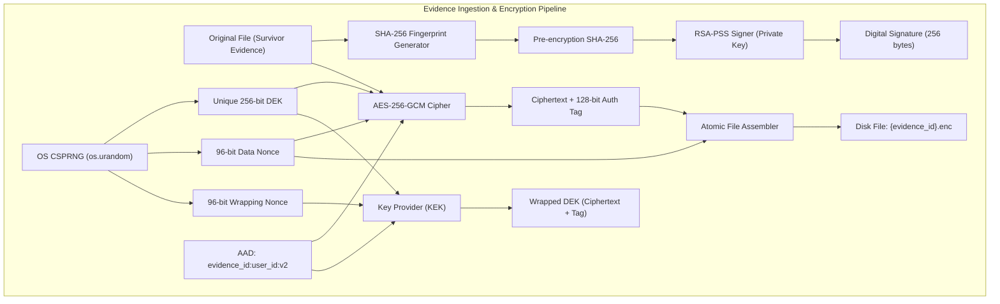
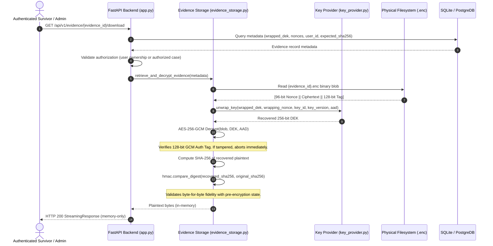

# SafeHER Stage 1 — Encryption Architecture
**Technical Specification & Cryptographic Protocols**
**Standard:** NIST SP 800-38D (AES-GCM), FIPS 186-4 (RSA-PSS), RFC 8017 (PKCS #1 v2.2)

---

## 1. Architectural Overview & Envelope Pattern

SafeHER employs a two-tier **Envelope Encryption** architecture to achieve cryptographically isolated security for survivor evidence:

1. **Data Encryption Key (DEK):** A 256-bit symmetric key uniquely generated for each evidence item using `os.urandom(32)`. The DEK encrypts the evidence payload using AES-256-GCM.
2. **Key Encryption Key (KEK):** A master key managed by a Key Provider (`BaseKeyProvider`) that wraps and protects DEKs. The local provider uses AES-256-GCM with a dedicated 96-bit wrapping nonce.



---

## 2. In-Memory Decryption & Retrieval Flow

Decryption is memory-only. SafeHER never writes temporary plaintext files to the disk cache or temp directories during download or API streaming.



---

## 3. Cryptographic Primitives & Parameters

| Component | Standard / Primitive | Parameter Specification | Security Purpose |
| :--- | :--- | :--- | :--- |
| **Payload Encryption** | AES-256-GCM | 256-bit key, 96-bit CSPRNG nonce, 128-bit auth tag | Confidentiality and integrity; hardware-accelerated via AES-NI. |
| **DEK Wrapping** | AES-256-GCM (KEK) | 256-bit master key, 96-bit CSPRNG wrapping nonce | Master key protection; enables key rotation without re-encrypting payloads. |
| **AAD Binding** | Authenticated Associated Data | `evidence_id:user_id:version` UTF-8 bytes | Prevents ciphertext swapping across users, incidents, or records. |
| **Digital Signature** | RSA-PSS | 2048-bit RSA, SHA-256 hash, MGF1 salt length 32 | Non-repudiation; cryptographically proves evidence was unaltered since creation. |
| **Atomic Persistence** | OS Atomic Replacement | `tempfile.mkstemp` + `os.fsync` + `os.replace` | Eliminates partial writes or corrupted files during power failure. |

---

## 4. Authenticated Associated Data (AAD) Specification

The AAD is injected into the AES-GCM engine during both encryption and decryption:
```python
def build_evidence_aad(evidence_id: str, user_id: str, version: str = "v2") -> bytes:
    return f"{evidence_id}:{user_id}:{version}".encode("utf-8")
```
### Security Invariant
If an adversary attempts to:
- Copy an encrypted evidence file from User A and attach it to User B's incident;
- Swap the database `evidence_id` pointing to a different payload;
- Replay ciphertext under an older schema version;

The AES-GCM decryption automatically fails with an `AuthenticationError` (`InvalidTag`), stopping unauthorized data leakage before any plaintext is generated.
