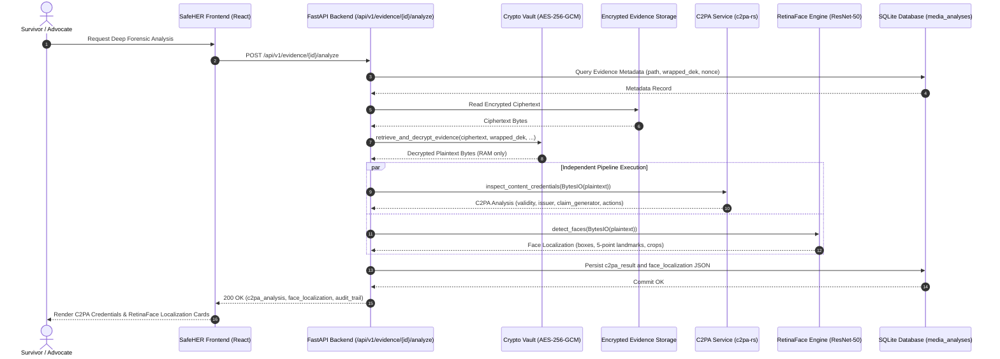
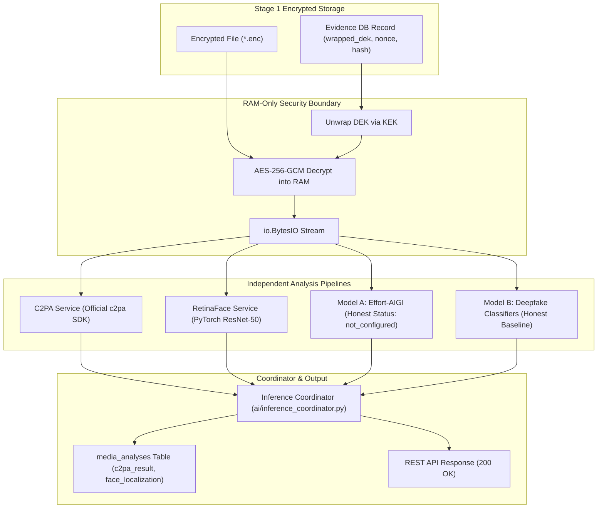
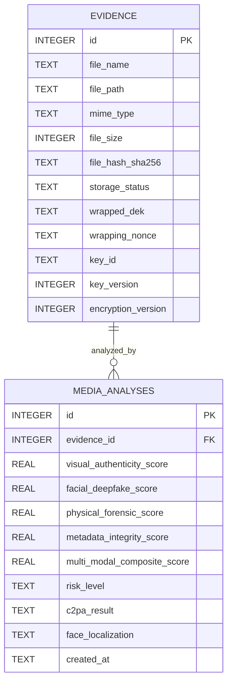

# SafeHER Stage 2: Evidence Analysis Architecture

## 1. System Overview

SafeHER Stage 2 bridges cryptographic evidence storage (Stage 1) with multi-modal forensic inspection. All analysis is performed **in-memory** on decrypted streams, preserving strict confidentiality while enabling deep provenance and visual inspection.

---

## 2. Evidence Analysis Sequence Diagram

---

## 3. Forensic Flow & Pipeline Independence

---

## 4. Database Schema Integration

The `media_analyses` table was updated with non-destructive migrations to store granular Stage 2 forensic outputs:

---

## 5. Security & Privacy Guarantees

1. **Zero Intermediate Plaintext**: Plaintext survivor images exist exclusively inside process memory during the lifecycle of the analysis request. No temporary swap files, thumbnail dumps, or scratch files are created on disk.
2. **Graceful Degradation**: The C2PA pipeline and RetinaFace pipeline execute inside guarded exception scopes. A failure or metadata absence in one domain cannot prevent execution or alter results in the other.
3. **Traceability**: All forensic responses include an analysis ID, SHA-256 evidence fingerprint, SDK version stamps, and execution timestamps for legal provenance.
