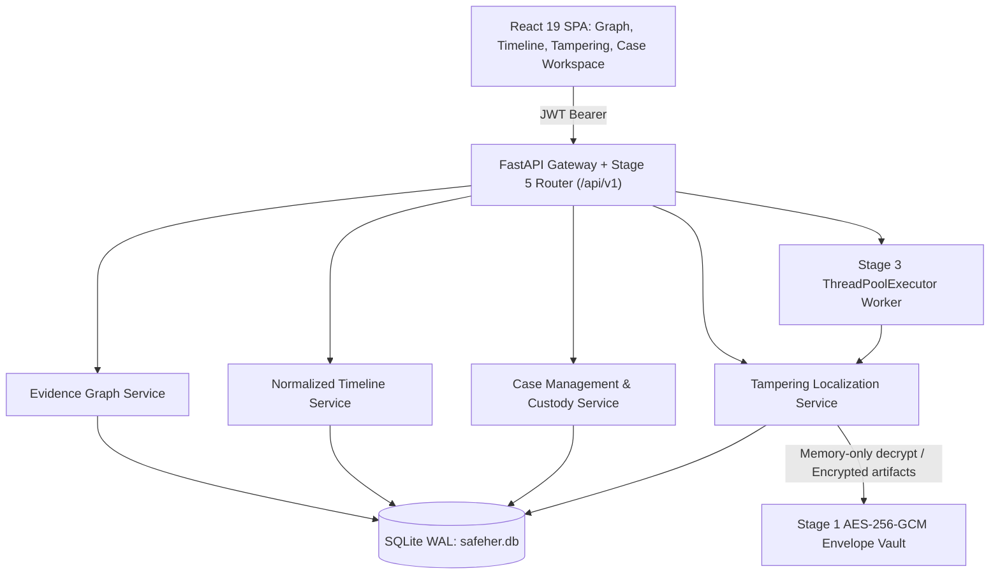

# SafeHER Stage 5 Forensic Architecture

## 1. System Overview
Stage 5 builds directly on SafeHER's existing FastAPI + SQLite WAL + React 19 + AES-256-GCM architecture without duplicating evidence, timeline, or case tables.

## 2. New Modules
- `backend/forensics/graph_service.py`
- `backend/forensics/timeline_service.py`
- `backend/forensics/case_service.py`
- `backend/forensics/router.py`
- `backend/ai/tampering_localization.py`
- `frontend/src/pages/forensics/EvidenceGraphPage.tsx`
- `frontend/src/pages/forensics/NormalizedTimelinePage.tsx`
- `frontend/src/pages/forensics/TamperingAnalysisPage.tsx`
- `frontend/src/pages/cases/CaseWorkspacePage.tsx`
