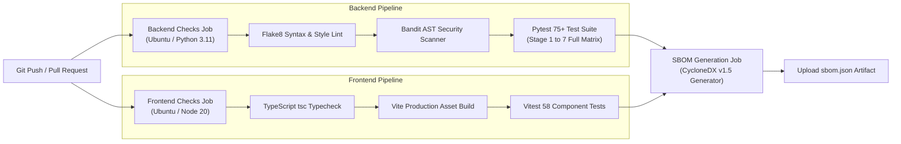

# SafeHER — CI/CD Automation & Software Bill of Materials (SBOM) Report
## Automated Testing Pipeline & CycloneDX v1.5 Dependency Inventory

---

### 1. Continuous Integration & Deployment Pipeline (`.github/workflows/ci.yml`)

The SafeHER CI/CD pipeline enforces automated quality gates on every code commit and pull request across both frontend and backend:

---

### 2. Software Bill of Materials (SBOM) Summary

The CycloneDX v1.5 JSON SBOM (`sbom.json`) was generated automatically via `backend/scripts/generate_sbom.py`.

#### Overall Inventory Metrics:
- **Total Components Cataloged**: 72
- **Backend Python Dependencies**: 45
- **Frontend npm Dependencies**: 27
- **Specification**: CycloneDX JSON Schema v1.5 (`urn:uuid:...`)
- **Root Component**: `pkg:generic/safeher@3.0.0` (License: MIT)

#### Key Component Categories:

| Category | Primary Packages | License | Role in SafeHER |
| :--- | :--- | :--- | :--- |
| **Web Framework & API** | `fastapi`, `starlette`, `uvicorn`, `pydantic` | MIT / BSD | REST API runtime & input validation |
| **Cryptographic Engine** | `pycryptodome`, `cryptography` | BSD / Apache-2.0 | AES-256-GCM, RSA-PSS, KEK wrapping |
| **Content Credentials** | `c2pa-python` | Apache-2.0 / MIT | C2PA Content Credentials extraction & verification |
| **Computer Vision & AI** | `torch`, `torchvision`, `facenet-pytorch`, `pillow` | BSD / Apache-2.0 | RetinaFace & deepfake forensic inference |
| **Frontend Foundation** | `react`, `react-dom`, `react-router-dom` | MIT | Core UI rendering & route management |
| **UI Styling & Icons** | `tailwindcss`, `lucide-react`, `clsx`, `tailwind-merge` | MIT / ISC | Responsive design & accessibility icons |
| **Testing & Quality** | `pytest`, `hypothesis`, `vitest`, `@testing-library/react` | MIT | Unit, property & component test execution |
