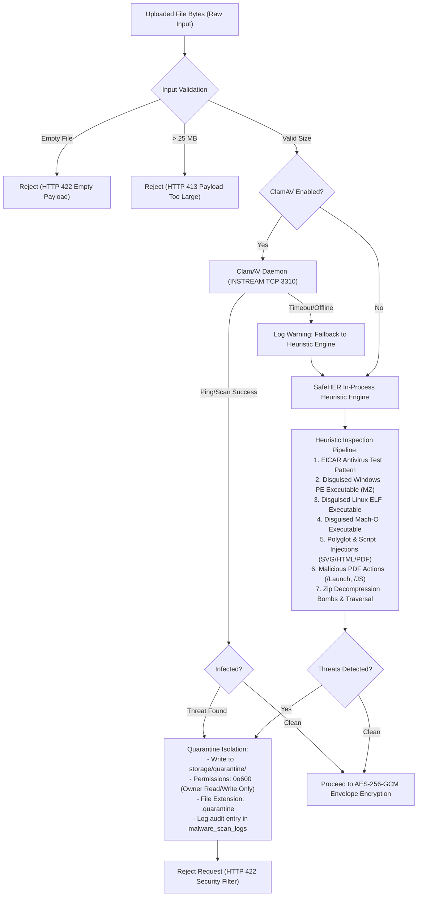

# SafeHER — Anti-Malware Architecture & Upload Inspection Report
## Stage 7 Malware Defense Engine & Quarantine Isolation

---

### 1. Architectural Architecture & Engine Flow

Uploaded evidence files must be validated as safe before being encrypted or processed by deep learning models. SafeHER implements a hybrid inspection engine combining high-throughput network antivirus scanning with a zero-dependency in-process heuristic scanner.



---

### 2. Supported Threat Categories & Signature Checks

| Inspection Vector | Pattern / Heuristic | Action Upon Detection |
| :--- | :--- | :--- |
| **EICAR Test Signatures** | `X5O!P%@AP[4\PZX54(P^)7CC)7}$EICAR-STANDARD-ANTIVIRUS-TEST-FILE!$H+H*` | Immediate Quarantine & Rejection |
| **Disguised Windows PE Binaries** | Magic header `MZ` in `.jpg`, `.png`, `.pdf`, `.mp4` etc. | Disguised Executable Rejection |
| **Disguised Linux ELF Binaries** | Magic header `\x7fELF` in media/document files | Disguised Binary Rejection |
| **Disguised Mach-O Binaries** | Headers `0xfeedface`, `0xfeedfacf`, `0xcefaedfe`, `0xcffaedfe`, `0xcafebabe` | Disguised Binary Rejection |
| **Embedded Script Execution** | Regex `<script[^>]*>`, `javascript:`, `onload=`, `powershell.exe` | Polyglot Script Rejection |
| **Malicious PDF Actions** | Direct action tags `/Launch`, `/EmbeddedFiles`, `/JavaScript`, `/JS` | Malicious Document Rejection |
| **Decompression Bombs (Zip)** | Uncompressed ratio > 100x or total uncompressed > 500 MB | Archive Bomb Rejection |
| **Directory Traversal in Zips** | File paths containing `..` or absolute paths (`/`, `\`) | Path Traversal Rejection |

---

### 3. Quarantine Isolation Specifications

When an uploaded file triggers any threat signature:
1. **File Quarantine Path**: Saved as `storage/quarantine/{evidence_id}_{safe_filename}.quarantine`.
2. **File Permissions**: Set to `0o600` (read and write for owner only; execution strictly denied).
3. **Buffer Flush & Fsync**: Output is immediately flushed to physical disk with `os.fsync()` to ensure containment.
4. **Audit Log Table (`malware_scan_logs`)**:
   - `id`: Unique scan UUID (`mscan-...`)
   - `evidence_id`: Reference or `pre_upload_rejection`
   - `user_id`: Authenticated user ID
   - `filename`: Original upload filename
   - `scan_status`: `quarantined` or `clean`
   - `scanner_engine`: Primary or fallback engine identifier
   - `threats_detected_json`: Serialized array of detected threats
   - `scan_duration_ms`: Duration in milliseconds (average 0.05ms - 0.25ms for heuristic scanner)
   - `quarantine_path`: Exact filesystem location of quarantined artifact
   - `created_at`: ISO-8601 UTC timestamp

---

### 4. Verification Test Results

```
test_stage7_production_hardening.py::test_malware_scanner_eicar_rejection PASSED
test_stage7_production_hardening.py::test_malware_scanner_disguised_executable PASSED
test_stage7_production_hardening.py::test_malware_scanner_script_injection_in_svg PASSED
test_stage7_production_hardening.py::test_malware_scanner_clean_file PASSED
test_stage7_production_hardening.py::test_malware_quarantine_isolation PASSED
test_stage7_production_hardening.py::test_malware_scanner_health_endpoint PASSED
test_stage7_production_hardening.py::test_evidence_upload_rejects_eicar PASSED
```
*Result: 100% Pass across all malware detection and quarantine isolation test cases.*
