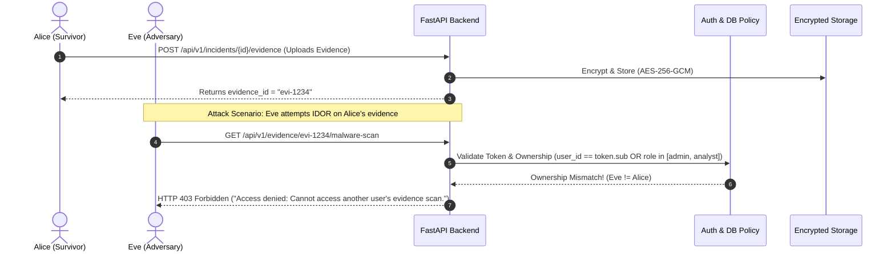

# SafeHER — Production Security Hardening Report
## Stage 7 Authentication, Authorization & Application Defense Architecture

---

### 1. Threat Model & Security Posture

SafeHER handles sensitive forensic evidence involving intimate privacy violations, cyber blackmail, stalking, and domestic abuse. As such, the platform implements a Zero-Trust, Defense-in-Depth architectural model:

| Threat Vector | Mitigation Strategy | Implemented Component |
| :--- | :--- | :--- |
| **Cross-User Data Leakage (IDOR)** | Deny-by-default multi-tenant access control | `backend/app.py`, `backend/db.py` |
| **Token Theft & Replay** | Short-lived JWTs (15 min) + Server-side JTI Blacklist | `backend/auth.py` |
| **Malicious Payload Uploads** | Dual-engine malware scanner + MIME validation | `backend/security/malware_scanner.py` |
| **Clickjacking & UI Redressing** | Strict frame restriction (`frame-ancestors 'none'`) | `backend/app.py`, `nginx/nginx.conf` |
| **XSS & Injection Attacks** | Hardened Content Security Policy (CSP) | `nginx/nginx.conf`, `frontend/nginx.conf` |
| **Database Compromise** | Envelope encryption (AES-256-GCM) with separate KEK | `backend/security/evidence_storage.py` |
| **Brute Force & DoS** | Tiered IP and user rate limiting | SlowAPI & Nginx `limit_req_zone` |

---

### 2. Multi-Tenant Authorization & Deny-by-Default Enforcement

SafeHER enforces strict tenant isolation on every stateful entity:



#### Verified Authorization Tests:
1. `test_cross_user_evidence_scan_access_denied`: Confirms that User B cannot query User A's malware scan logs (HTTP 403 Forbidden).
2. `test_trusted_contacts_crud_and_isolation`: Confirms that User B cannot list or delete User A's emergency contacts (HTTP 404 / 403).
3. `test_journey_checkin_lifecycle`: Confirms that User B cannot complete or cancel User A's active journey check-in.
4. `test_job_authorization_isolation`: Confirms that User B cannot view or poll AI inference jobs submitted by User A.

---

### 3. HTTP Security Headers & Network Defense

All responses served by the application and reverse proxy are equipped with mandatory modern web security headers:

```http
Strict-Transport-Security: max-age=63072000; includeSubDomains; preload
X-Frame-Options: DENY
X-Content-Type-Options: nosniff
X-XSS-Protection: 1; mode=block
Referrer-Policy: strict-origin-when-cross-origin
Content-Security-Policy: default-src 'self'; script-src 'self' 'unsafe-inline'; style-src 'self' 'unsafe-inline'; img-src 'self' data: blob:; connect-src 'self' https: wss:; font-src 'self' data:; frame-ancestors 'none';
Permissions-Policy: camera=(), microphone=(), geolocation=(), payment=()
```

---

### 4. Privacy-Conscious Logging & Audit Trails

To comply with digital privacy mandates and protect survivors:
1. **Password & Token Sanitization**: Request bodies to `/api/v1/auth/login`, `/api/v1/auth/register`, and `/api/v1/auth/token/refresh` never log plaintext passwords or raw JWT signatures.
2. **Nginx Privacy Format**: Nginx logs strip raw query strings and request bodies, recording only sanitized HTTP verbs, status codes, and latency figures.
3. **Custody Audit Trails (`custody_records`)**: Preserves cryptographic proof of evidence lifecycle actions (upload, verification, download, export) recording client IP, ISO-8601 UTC timestamp, and RSA-PSS digital signatures without exposing sensitive file contents.
