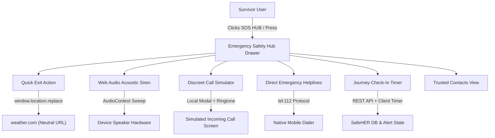

# SafeHER — Survivor Safety & Protection Implementation Report
## Stage 6 Technical Architecture, Behavioral Guidelines & Limitation Disclosures

---

### 1. Architectural Philosophy & Ethics

Survivor safety features in SafeHER are built on four inviolable engineering principles:
1. **Never Make False Claims**: The application must never claim to place automated telephone calls, contact emergency police services silently, or guarantee physical intervention unless technically capable.
2. **Transparent Browser Limitations**: Web applications run in a sandboxed client environment with inherent OS constraints (background suspension, local browser caching). These constraints must be explicitly communicated.
3. **Trauma-Informed Rapid Controls**: Features must be intuitive under extreme emotional stress, requiring minimal clicks, clear high-contrast visual cues, and resilient error handling.
4. **Discreet Local Execution**: Distraction and deterrent tools must operate entirely client-side without creating suspicious network activity or tracking logs.

---

### 2. Feature Analysis & Implementation Details

#### 2.1 Accessible Emergency Hub Drawer (`EmergencyDrawer.tsx`)
- **Mount Point**: Mounted at the application root via `Navbar.tsx` and accessible across all routes.
- **Trigger**: Clickable "SOS HUB" header badge with pulsing indicator and dedicated keyboard shortcut.
- **State Cleanup**: On drawer unmount or closing, active oscillators and countdown intervals are cleanly terminated to prevent audio leakage.

#### 2.2 Quick Exit Engine (`QuickExitButton.tsx`)
- **Navigation Method**: `window.location.replace("https://www.weather.com")`.
  - Replaces the current entry in the browser's history stack so pressing the browser's "Back" button does not return to SafeHER.
- **Global Keybinding**: `Alt + Q`.
  - Global capturing keyboard event listener.
  - Includes debouncing lock (`globalExitInProgress`) to prevent race conditions or duplicate executions.
- **In-Memory Cache Evacuation**: Session state and temporary draft storage are cleared before navigation.
- **Honest Security Disclosure**:
  > **Notice to Survivors**: Quick Exit rapidly navigates to an innocuous weather site. However, local browser history, cached assets, and Wi-Fi router DNS queries are retained by standard browsers. Survivors are explicitly advised to use Private Browsing / Incognito windows and to wipe browser history when in a safe environment.

#### 2.3 Acoustic Deterrent Siren (Web Audio API)
- **Audio Synthesis**: Clean-room audio oscillator implementation using the standard W3C Web Audio API.
  - Waveform: `sawtooth` for maximum acoustic sharpness and attention.
  - Modulation Sweep: Linearly ramps frequency from 700 Hz to 1200 Hz and back to 700 Hz on a 1-second period.
- **Volume & Safety Control**:
  - Linear gain node connected to `AudioContext.destination`.
  - Adjustable slider (0% to 100%, default 80%).
- **Auto-Shutoff Timer**:
  - Automatically silences after 30 seconds (configurable between 10s and 120s in settings) to prevent runaway alarms.
  - Hardware cleanup: explicitly invokes `AudioContext.close()` to release the device sound card.

#### 2.4 Discreet Call Simulator (`FakeCallModal.tsx`)
- **Purpose**: Provides survivors with a realistic, convincing excuse to exit uncomfortable, coercive, or threatening in-person encounters.
- **Ringtone Generation**: Web Audio dual-frequency pulse (440 Hz + 480 Hz US standard ring pattern) repeating every 3.5 seconds.
- **Customizable Identity**: Pre-configured profiles ("Mom", "Office / Manager", "Taxi Driver", "Doctor's Clinic") or custom text.
- **Delayed Triggering**: Allows survivors to schedule the fake call with a 5, 10, or 30-second delay so they can put their phone on a table naturally before the ring starts.
- **Simulation Flow**:
  1. Ringing Screen: Displays caller initial badge, glowing ping animation, "Incoming audio call...", and Accept / Decline buttons.
  2. Active Call Screen: Displays "Call Connected", live call timer (`00:01`, `00:02`...), and "End Call" button.
- **Ethical Boundary**: Runs purely in the local DOM; does not use VoIP gateways or caller-ID spoofing services.

#### 2.5 Direct Emergency Helplines
- **Invocation**: Standard URI schemes invoking operating system native capabilities:
  - `tel:112`: All-in-one Emergency (Police, Fire, Ambulance — India & EU standard).
  - `tel:1091`: Dedicated Police Women Helpline (India).
  - `tel:181`: Women in Distress / NCW Helpline (India).
- **Limitation Notice**: Web applications cannot force calls to connect without user dialer confirmation.

#### 2.6 Journey Check-In Engine (`backend/app.py` & `db.py`)
- **Endpoints**:
  - `POST /api/v1/safety/journey/start`: Records destination, expected duration, and linked contact.
  - `POST /api/v1/safety/journey/{id}/checkin`: Marks journey as `completed_safely`.
  - `POST /api/v1/safety/journey/{id}/cancel`: Marks journey as `cancelled`.
  - `GET /api/v1/safety/journey/active`: Returns active timer or flags as `expired` if current time exceeds expiry.
- **Browser Background Tab Limitation Disclosure**:
  > **Operating System Tab Throttling**: Modern browsers (Google Chrome, Microsoft Edge, Apple Safari on iOS/macOS) throttle `setInterval` timers in background tabs to save battery. SafeHER displays a prominent banner advising survivors to keep the SafeHER browser tab active or pinned to ensure real-time timer accuracy.

#### 2.7 Trusted Contacts Management
- **Endpoints**:
  - `GET /api/v1/safety/contacts`: Retrieves authenticated user's contacts.
  - `POST /api/v1/safety/contacts`: Adds new contact with phone validation.
  - `DELETE /api/v1/safety/contacts/{id}`: Deletes contact with strict multi-tenant boundary checks.
- **UI Integration**: One-touch direct `tel:` dialing buttons directly inside the drawer.
