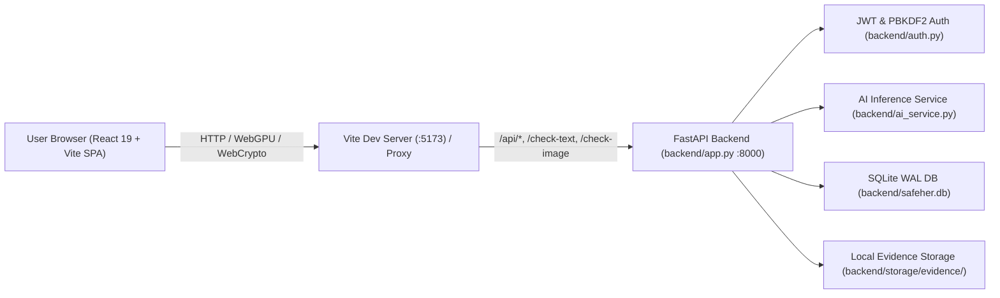
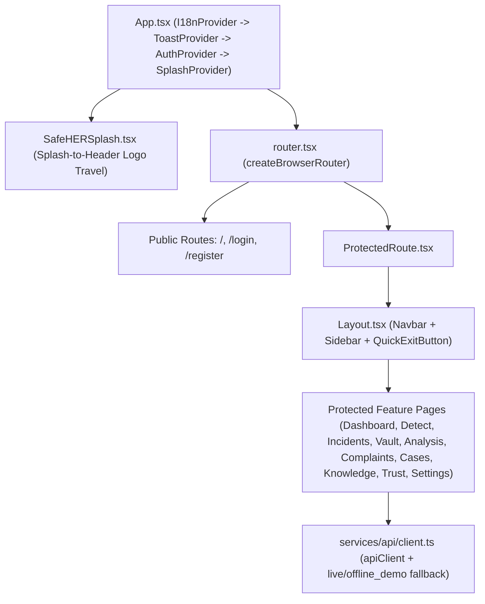

# 02 — System Architecture

## High-Level Architecture

SafeHER follows a decoupled client-server architecture:
- **Browser SPA (`frontend/`)**: Served on `http://localhost:5173` in development (or built to `frontend/dist/`). In development, Vite proxies `/api`, `/check-text`, and `/check-image` to `http://127.0.0.1:8000`.
- **FastAPI Backend (`backend/app.py`)**: Runs on `http://127.0.0.1:8000`, handles authentication, validation, business logic, evidence file persistence, and invokes `backend/ai_service.py` for ML inference.
- **SQLite Database (`backend/safeher.db`)**: Single-file relational store configured with Write-Ahead Logging (`WAL`), foreign key enforcement, and 5-second busy timeout.
- **Evidence Storage (`backend/storage/evidence/`)**: Stores uploaded evidence files indexed by UUID and SHA-256 digest.

---

## Frontend Architecture Layers (`frontend/src/`)

---

## Key Architectural Decisions

1. **Same-Origin Dev Proxy**: `frontend/vite.config.ts` proxies `/api`, `/check-text`, and `/check-image` to `http://127.0.0.1:8000`, avoiding cross-origin friction during local development while keeping relative API paths clean.
2. **Resilient API Client (`live` vs `offline_demo`)**: `apiClient` in `frontend/src/services/api/client.ts` treats HTTP `4xx/5xx` responses as real `ApiError` exceptions (never masking server validation errors), and only switches to `offline_demo` mode if the backend is unreachable (network/timeout error) or `VITE_USE_MOCK_API=true`.
3. **Graceful WebGPU Degradation**: The landing page and 3D views (`SpiralGalaxyHeroBackground`, `HolographicWhitePaperCard`, `SafeHERLogoLed3D`) use `vgpu` and `.wgsl` shaders when `navigator.gpu` and adapter/device initialization succeed, and fall back seamlessly to CSS/SVG visuals in headless or non-WebGPU environments.
4. **Thread-Safe Lazy AI Loading**: `backend/ai_service.py` loads HuggingFace pipelines lazily behind a `threading.Lock()` (`_model_lock`) so FastAPI startup remains fast even before the first inference call.

---

## Related Documents

- [03_THREE_MEMBER_INTEGRATION_GUIDE.md](03_THREE_MEMBER_INTEGRATION_GUIDE.md)
- [06_BACKEND_FASTAPI_REFERENCE.md](06_BACKEND_FASTAPI_REFERENCE.md)
- [Member 3 Architecture Overview](member-3/01_FRONTEND_ARCHITECTURE.md)
