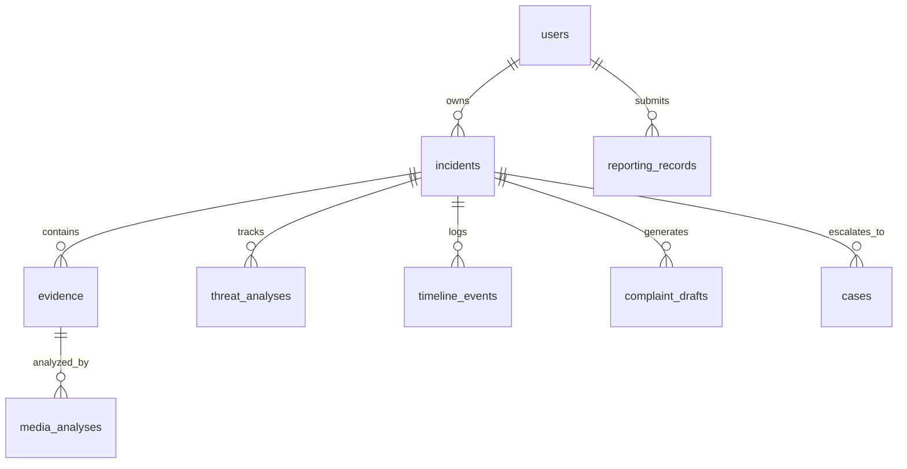

# 07 — Database Schema & Storage

## SQLite Configuration (`backend/db.py`)

SafeHER uses SQLite3 configured via `get_db_connection()` with:
- `PRAGMA journal_mode=WAL;` — Enables concurrent reads while writes occur.
- `PRAGMA foreign_keys=ON;` — Enforces referential integrity across user, incident, evidence, and analysis records.
- `PRAGMA busy_timeout=5000;` — Prevents transient `database is locked` errors under concurrent requests.
- `sqlite3.Row` row factory for dictionary-like column access.

Default database path: `backend/safeher.db` (overridable via `SAFEHER_DB_PATH`).

---

## Entity-Relationship Overview

---

## Table Inventory (9 Tables in `backend/db.py`)

1. **`users`** — Registered accounts (`id`, `name`, `email`, `password_hash`, `consent_acknowledged`, `consent_date`, `preferred_language`, `created_at`).
2. **`incidents`** — User-logged abuse incidents (`id`, `user_id`, `title`, `category`, `description`, `incident_date`, `incident_time`, `platform`, `relevant_urls`, `suspected_abuse_type`, `additional_notes`, `status`, `created_at`, `updated_at`).
3. **`evidence`** — Preserved files linked to an incident (`id`, `incident_id`, `user_id`, `original_filename`, `stored_filename`, `file_type`, `file_size`, `sha256_hash`, `upload_timestamp`, `storage_status`, `validation_status`, `malware_status`, `processing_status`, `duplicate_status`, `notes`).
4. **`media_analyses`** — Image/media AI scan results (`id`, `evidence_id`, `incident_id`, `user_id`, `media_type`, `model_name`, `model_version`, `deepfake_score`, `nudity_score`, `is_calibrated`, `uncertainty_state`, `decision`, `c2pa_json`, `explanation`, `analyzed_at`).
5. **`threat_analyses`** — Text toxicity/threat scan results (`id`, `incident_id`, `user_id`, `input_text`, `toxicity_score`, `insult_score`, `threat_score`, `severity_label`, `decision`, `categories_json`, `explanation`, `analyzed_at`).
6. **`timeline_events`** — Chronological incident events (`id`, `incident_id`, `user_id`, `event_type`, `title`, `description`, `timestamp`, `source`).
7. **`complaint_drafts`** — Generated and edited legal complaint drafts (`id`, `incident_id`, `user_id`, `title`, `summary`, `legal_sections_json`, `recommended_actions_json`, `status`, `created_at`, `updated_at`).
8. **`cases`** — Case tracking items (`id`, `incident_id`, `user_id`, `case_reference`, `authority`, `status`, `notes`, `updated_at`).
9. **`reporting_records`** — External portal submission records (`id`, `incident_id`, `user_id`, `destination_id`, `destination_name`, `reference_number`, `notes`, `submitted_at`).

---

## Local Evidence File Storage

- Default directory: `backend/storage/evidence/` (overridable via `SAFEHER_STORAGE_DIR`).
- Files are saved with generated UUID-based names and indexed in `evidence.stored_filename`.
- Never commit `backend/safeher.db` or `backend/storage/` contents to Git.
